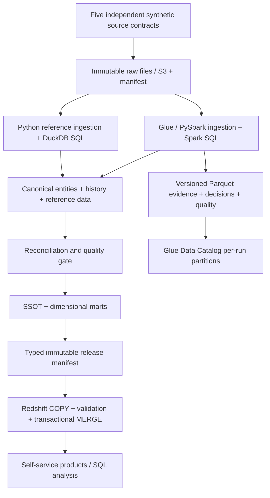

# Multi-Carrier Logistics Canonical Data Platform

### Building a trustworthy Single Source of Truth from inconsistent operational systems

[](https://github.com/andrebarrocas/logistics-data-platform/actions/workflows/ci.yml)

An independently designed Data Engineering portfolio: five synthetic operational feeds become explainable canonical entities, effective-dated reference data, and reconciled analytical products. The difficult work is in identity, history, conflict resolution, completeness, and recovery.

**All operational records are generated by this repository.** Aster Parcel, Meridian Freight, and Vale Courier are fictional. This project has no association with Amazon or any real logistics company. AWS service names identify technologies used; no proprietary schemas, internal architecture, confidential terminology, or production performance claims are included.

## Run the working platform

Use Python 3.11 on Linux or macOS. The local writer uses POSIX file locking. Windows users can run it in WSL.

```bash
python3.11 -m venv .venv
source .venv/bin/activate
python -m pip install -e '.[dev,aws]'

# Full load, corrected incremental load, then an identical no-op replay.
logistics demo --output work/demo --shipments 1000 --seed 42

# Eight independent incidents, each with detection, recovery and replay assertions.
logistics incidents --output work/incidents --shipments 12

pytest -m 'not spark'
ruff check src tests scripts jobs
mypy src
```

A tiny manifested fixture is also checked in under [`examples/input`](examples/input); its raw bytes are protected from Git line-ending conversion. Generation refuses to overwrite an existing input batch. Choose a new output directory for a fresh demonstration. To replay an existing batch safely:

```bash
logistics run work/demo/input/batch002/manifest.json \
  --database work/demo/warehouse.duckdb

logistics query --database work/demo/warehouse.duckdb --sql \
  "SELECT carrier_name, count(*) shipments FROM ssot_shipments GROUP BY carrier_name"

logistics query --database work/demo/warehouse.duckdb --sql \
  "SELECT currency, sum(amount_minor) cents FROM ssot_transportation_costs GROUP BY currency"
```

Every execution creates structured quality evidence under the database's `runs/` directory and in `pipeline_runs` / `quality_results`. Raw bytes are retained under content hashes. A failed required feed leaves the published warehouse and watermark unchanged. Warnings remain visible in the run results and product quality indicators.

## What to inspect first

| Engineering signal | Executable implementation | Evidence |
|---|---|---|
| Advanced SQL and history | [Reference SCD SQL](src/logistics_platform/sql/001_reference.sql): corrected boundaries, `LAG`, running-sum islands, `LEAD`; [fact attribution](src/logistics_platform/sql/003_marts.sql): business-time joins | [Warehouse semantic tests](tests/test_warehouse.py) |
| Identity and conflicting sources | [Resolver](src/logistics_platform/resolution.py), [state selection SQL](src/logistics_platform/sql/002_canonical.sql) | Ambiguous aliases never select a winner; equal-authority state ties block publication |
| Incremental correctness | [Transactional pipeline](src/logistics_platform/pipeline.py), explicit revision ledger and publication cursor | [Replay/correction/tombstone/early-dimension tests](tests/test_pipeline_contracts.py) |
| Reconciliation and troubleshooting | Manifest controls, exact signed monetary bridges, unknown-rate gates, SQL foreign-key/as-of checks | [Eight incident exercises](docs/incident-runbook.md), [regression tests from review](tests/test_review_regressions.py) |
| PySpark | [Glue job](src/logistics_platform/spark_job.py): distributed canonical/SCD SQL, temporal attribution, retained evidence, gated multi-file releases | [Full and incremental integration](tests/test_spark_integration.py), [all-product SQL parity](tests/test_spark_warehouse.py), Java 17 / Spark 3.5.4 |
| AWS / Redshift | [Terraform](infra/), [typed snapshot publication](src/logistics_platform/cloud.py), transactional `COPY` / fact `MERGE`, durable run ledger | Infrastructure validation and [mocked integrity tests](tests/test_cloud.py); live acceptance is separate |
| Warehouse optimization | [Redshift workload and inspection SQL](sql/redshift/), [benchmark harness](scripts/benchmark_redshift.py) | [Actual local measurements](docs/benchmarks.md); no invented Redshift results |

## Architecture and execution boundaries



The **local pipeline** is the executable correctness reference. The **Glue job** runs distributed ingestion, deterministic resolution, canonical/SCD projections, all 24 product tables, reconciliation, and bounded CSV release sharding. Both profiles feed the same **Redshift publisher**, which verifies the selected release before a warehouse transaction. Real local Spark tests exercise full and corrected incremental releases; all 24 product relations are compared with the local SQL engine. The [AWS deployment guide](docs/aws-deployment.md) gives the operator commands, retry boundaries, and separate live acceptance requirements.

Both engines incrementally accept source revisions and rebuild complete product projections from retained evidence. The local engine publishes them in a single transaction; Spark publishes an immutable release after quality gates. This deliberately favors testable correction semantics over a claim of constant-cost processing. It is not a distributed production warehouse substitute. Redshift fact publication uses staged `MERGE`; corrected dimension timelines are replaced atomically from the validated snapshot.

## The model

Canonical entities: Order, Shipment, Package, Carrier, Facility, Route, Country, Region, and ServiceLevel. Source IDs remain namespaced; business keys express governed identity; UUID5 canonical IDs are stable; separate positive BIGINT surrogate keys identify dimensional versions. Unknown dimension key `0` is an actual row, and unknown usage is measured separately from foreign-key validity.

| Fact | Grain | Dimension business time |
|---|---|---|
| `fact_shipment` | One current accumulating snapshot per canonical shipment, including tombstones | Shipment creation |
| `fact_delivery_event` | One current revision per namespaced logical source observation | Event occurrence |
| `fact_transportation_cost` | One current nondeleted source cost entry; signed EUR minor units | Cost incurrence |

State authority is verified shipment-level carrier evidence, then observed operations, then unverified/package observations. A single package's delivery does not prove whole-shipment delivery. Source revision corrections supersede old observations before ranking. Conflicting evidence remains queryable.

Display labels use SCD Type 1; operational classifications use Type 2 with half-open validity intervals. Backdated corrections rebuild affected interpretations and restate foreign keys. Append-only source revisions and publication snapshots retain prior knowledge. This is a restated valid-time warehouse with recorded publication audit, not an unimplemented claim of universal bitemporal querying.

## Spark, backfills and cloud publication

```bash
# Java 17 must be available in JAVA_HOME.
python -m pip install -e '.[dev,aws,spark]'
SPARK_LOCAL_IP=127.0.0.1 pytest -m spark
python scripts/build_glue_zip.py

# Local Spark with the same job as Glue; use a new immutable attempt prefix.
spark-submit --master 'local[2]' --py-files dist/logistics_platform.zip jobs/normalize.py \
  --manifest_uri "$PWD/work/demo/input/batch001/manifest.json" \
  --output_uri "$PWD/work/spark/attempt001" \
  --build_products --release_uri "$PWD/work/spark-release-001" \
  --release_id release_001

# Replaying published batches does not replace newer knowledge with old snapshots.
logistics backfill --input work/demo/input --database work/demo/warehouse.duckdb \
  --start 1 --end 2

# Export only a committed, quality-checked product snapshot for optional cloud loading.
logistics export --database work/demo/warehouse.duckdb \
  --output work/release --release-id synthetic-release-0002

terraform -chdir=infra init -backend=false
terraform -chdir=infra validate
python scripts/validate_redshift_sql.py
```

AWS deployment is opt-in and incurs service charges. No credentials are needed for local execution, tests, SQL parsing, or Terraform validation. `requirements.lock` records the complete tested dependency environment; install it before `pip install --no-deps -e .` when reproducing that exact environment. Live AWS execution requires an existing private VPC/subnet configuration and authorized AWS session. The infrastructure caps concurrency and Redshift capacity and includes a compute usage limit; these are operational controls, not a guarantee of zero cost.

## Measurements and verification

The checked-in benchmark measures **1,000,000 independently generated local SQL rows**, seven repetitions per variant, identical result checksums, exact EXPLAIN ANALYZE plans, and environment details. It compares unordered data, date-ordered data and a daily preaggregation. Sub-millisecond warm local timings describe only that workload; they do not establish Redshift performance or production capacity. See [benchmark protocol and results](docs/benchmarks.md).

The final local verification passed **104 tests: 95 Python/SQL/cloud-contract tests and 9 real Spark tests**. A wheel installed into an isolated target also processed the checked-in full/incremental fixtures and repeated the second batch without changing published data. [Sample incremental quality report](reports/sample-incremental-run.json).

[GitHub Actions](.github/workflows/ci.yml) runs unit/integration/SQL-quality tests, linting, formatting, type checking, real local Spark tests, Redshift dialect validation and Terraform validation. It never provisions infrastructure. [Verification record](reports/verification.json) distinguishes commands run locally from unexecuted cloud acceptance.

The workflow also builds and installs the wheel in a separate environment, then runs the public demo and exports its complete 24-product release. See the [29 October 2026 verification](docs/project-walkthrough.md#verification-on-29-october-2026) for fresh-checkout results and the CI issue found and repaired during that review. The badge above reflects the current branch's actual GitHub Actions status.

## Design and operational documentation

Phase 0 artifacts existed and were reconciled before implementation; see the [design gate](docs/phase-0-review.md).

- [Business requirements](docs/business-requirements.md), [source specifications](docs/source-systems.md), [architecture and lineage](docs/architecture.md)
- [Domain model](docs/domain-model.md), [canonical model and keys](docs/canonical-model.md), [dimensional model and grains](docs/dimensional-model.md)
- [Entity resolution](docs/entity-resolution.md), [source precedence](docs/source-precedence.md), [execution contract](docs/execution-contract.md)
- [Quality and reconciliation](docs/data-quality.md), [incident runbook](docs/incident-runbook.md), [self-service product catalog](docs/data-products.md)
- [Spark warehouse execution](docs/spark-warehouse.md), [observed Spark planning incident](docs/spark-plan-incident.md), [machine-readable product schemas](docs/catalog.json)
- [AWS deployment](docs/aws-deployment.md), [benchmarks](docs/benchmarks.md), [implementation roadmap](docs/implementation-roadmap.md), [ADRs](docs/adr/)

The release is ready for independent code review and reproducible local evaluation. Cloud infrastructure/API contracts are validated offline; deployed Glue acceptance and live Redshift performance are explicitly unverified until those commands run against a real environment.
