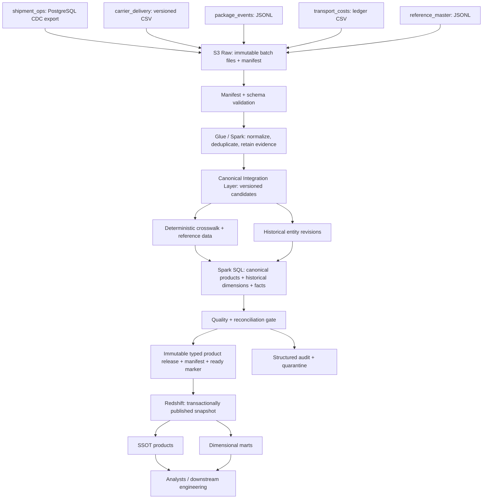
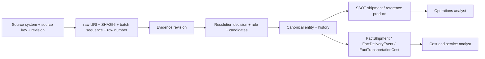

# Architecture

This independent portfolio uses invented operational data and fictional carriers. It has no affiliation with a logistics company or cloud vendor. AWS service names describe deployment targets only.

## Execution profiles

The local Python/DuckDB profile is the executable correctness reference. It reads the same manifests as the Spark profile and persists operational metadata, source evidence, canonical history, quality results and analytical SQL. DuckDB provides inexpensive repeatable relational tests; it does not simulate Redshift distribution, WLM, network or column encoding.

The deployable AWS profile targets immutable S3 objects, Glue 5.0 / Spark 3.5.4, Glue Catalog, Redshift Serverless and CloudWatch. The implemented Spark path now connects all five manifested inputs through normalization, deterministic resolution, typed canonical staging, historical reference reconstruction, facts, SSOT products, quality gates, and a typed 24-product release. This full/incremental flow and separate all-product SQL parity have passed locally. Spark performs the business transformations; it does not delegate them to DuckDB.

The release manifest and ready marker establish a validated object-store snapshot. The Redshift loader verifies its declared files, loads typed staging, and commits product replacement/merges with the durable release ledger and cursor in a warehouse transaction. Internal Parquet materialization and a successful Spark job do not by themselves establish warehouse commitment. Cloud infrastructure is opt-in; live Glue/Redshift execution has not been performed. See [AWS deployment](aws-deployment.md), [Spark implementation](spark-warehouse.md), and [the local recovery evidence](spark-plan-incident.md).

## Correctness boundaries

1. A manifest declares all required source datasets, hashes, row counts and cost controls. Validate bytes before parsing; repeated content from the same source is a no-op.
2. Adapters turn explicitly supported schema versions into a common evidence envelope. Unknown versions fail closed. Raw input is retained independently of success.
3. Namespaced source record identifiers and monotonically increasing revisions identify changes. Identical revisions with different payloads are errors. Deletes are tombstones, not erasure.
4. Explicit globally issued shipment/order/package keys and effective-dated curated aliases establish identity. Ambiguity produces an unresolved decision and a quality result.
5. Reference timelines and affected canonical entities are recomputed from accepted evidence. Incremental ingestion does not filter on event time. A bounded backfill selects ingestion sequences and preserves the same quality gate.
6. Relational publication and watermark advance occur in one transaction. Failures persist diagnostic results without exposing partial marts. Crash recovery retries from the last committed publication. A single writer is enforced in the local profile; cloud execution is serialized.

## Lineage

Lineage includes rejected evidence. Rejected attempts do not become authoritative and do not advance watermarks. Published source revisions remain auditable after later corrections. Reprocessing materializes the current interpretation; audit records preserve when each interpretation became known.

## Operational scope

Synthetic workload size is configurable. A small scenario suite is suitable for CI. Scale experiments run independently, record their exact row counts and machine/runtime metadata, and retain EXPLAIN output. No production throughput, availability, or Redshift performance claim is inferred from local results.
