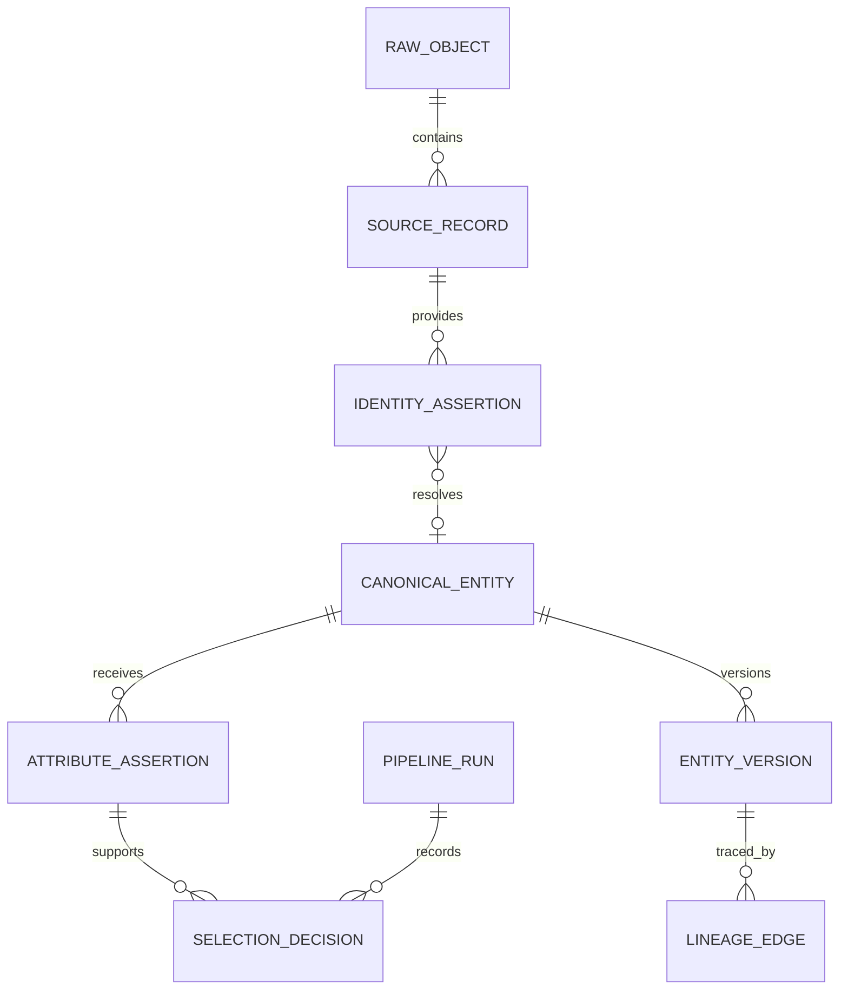

# Canonical model

The canonical layer is the integration boundary between source observations and analyst-facing products. It separates identity from representation and retains source evidence when assertions disagree. All identifiers, mappings, and operational facts are independently synthetic.

## Four kinds of keys

| Key class | Example | Generation and purpose |
|---|---|---|
| Source-system identifier | `(shipment_ops, shipment, OPS-SHP-001042)` | Supplied by the source, namespaced by source system and entity type; identifies one source record, not a universal entity. |
| Natural/business key | `SHP-001042` | An explicitly contracted global shipment key, carried by the source or confirmed by a curated crosswalk. Immutable after assignment. A source-specific tracking number is not automatically global. |
| Canonical identifier | UUID5 of `shipment:SHP-001042` | Deterministic across reloads and environments using the fixed namespace below. Unifies records only after evidence validates the business key. |
| Surrogate key | A computed `carrier_sk BIGINT` | Deterministic positive signed-63-bit integer from SHA256 of entity type, canonical ID, and effective-from timestamp. Identifies one dimensional version; collision checks are mandatory. Facts resolve it through canonical identity and business validity. `0` is reserved for the unknown member. |

The fixed project UUID namespace, generated by `uuid.uuid5(uuid.NAMESPACE_URL, 'https://example.invalid/mcl-platform')`, is `8f26e0b2-3dc4-5a22-8f76-2f6febc6df22`. Canonical IDs are `uuid.uuid5(namespace, f"{entity_type}:{business_key}")`, with lowercase entity type and an exact canonical business-key representation. Normalization may trim whitespace and uppercase a key only when the source contract explicitly permits it. Generated business-key patterns are `ORD-`, `SHP-`, `PKG-`, `CAR-`, `FAC-`, `RTE-`, `REG-`, and `SVC-`; Country uses a validated uppercase alpha-2 key such as `PT`. UUID5 is a reproducibility mechanism, not proof of identity: unsupported keys must not reach it.

Canonical keys never derive from a mutable label, row position, current timestamp, or fuzzy similarity. Reassigning a source key to a different business key is a contract violation; the supported source contract requires a new source identifier for the different entity. A later revision of the same business identity is handled under its upsert/tombstone lifecycle. An identity correction records a superseded mapping and its replacement, including affected facts and runs.

## Entity schema

The table below uses conceptual domain names; it is not a literal SQL DDL contract. [execution-contract.md](execution-contract.md) specifies exact adapter/staging fields, and [catalog.json](catalog.json) contains the actual local product schemas. For example, `canonical_order` uses `canonical_id`, `business_key`, `created_at`, `country_id`, and `is_deleted` plus lineage; it does not project `customer_reference`, `order_business_key`, or a separate `ordered_at` column.

Every reference interface exposes `canonical_id`, `business_key`, `status`, `effective_from`, `effective_to`, `recorded_at`, `source_updated_at`, `modified_at`, `source_system`, `source_id`, `raw_hash`, and `run_id`. Conceptual `valid_from`/`valid_to` map to physical `effective_from`/`effective_to`; lineage is the source ID, raw-object hash, and publication run. `valid_to = 9999-12-31T00:00:00Z` represents the open-ended final interval. Validity is half-open. `status` is `ACTIVE` or `INACTIVE`; unresolved mappings live in the resolution ledger and do not masquerade as valid reference rows.

| Entity | Business fields | Invariants |
|---|---|---|
| Order | Conceptual order identity, business key, creation time, and country | One canonical row per order key. Customer-reference concepts are outside the implemented projection and are not identity evidence. |
| Shipment | `shipment_id`, `shipment_business_key`, `order_id`, `carrier_id`, `origin_facility_id`, `destination_facility_id`, `route_id`, `service_level_id`, `created_at`, `promised_at`, `selected_state`, `is_deleted` | One shipment per key; both endpoints must agree with the selected route; state selection has an assertion ID. |
| Package | `package_id`, `package_business_key`, `shipment_id`, `weight_grams`, `is_deleted` | Nonnegative integral weight; one owning shipment at a valid instant. Missing weight remains null. |
| Carrier | `carrier_id`, `carrier_business_key`, `display_name`, `operating_status`, `default_service_id` | Display label is Type 1; operating attributes use Type 2. |
| Facility | `facility_id`, `facility_business_key`, `display_name`, `country_id`, `region_id`, `operating_status` | Country must resolve to a supported country; region assignment uses Type 2. |
| Route | `route_id`, `route_business_key`, `origin_facility_id`, `destination_facility_id`, `distance_km`, `operating_status` | Directed endpoints; no negative distance; endpoint or operating-policy change uses Type 2. |
| Country | `country_id`, `country_business_key`, `country_name` | Validated alpha-2 key; country label corrections are Type 1. |
| Region | `region_id`, `region_business_key`, `region_name` | Project-defined region identifier; label correction is Type 1. Facility membership is Type 2 on Facility. |
| ServiceLevel | `service_level_id`, `service_level_business_key`, `display_name`, `target_business_days`, `operating_status` | Label is Type 1; promise and availability use Type 2. |

`carrier_reference`, `facility_reference`, `route_reference`, `country_reference`, and `service_level_reference` are authoritative reusable reference interfaces over the corresponding validated entities. `region_reference` is also supplied so facilities do not contain ungoverned region text. Each exposes canonical ID, business key, canonical value, provenance, effective dates, status, lineage, and modification/recording timestamp.

The following diagram names logical responsibilities; it does not declare extra physical tables beyond the documented evidence, decision, projection, and audit interfaces.

## Shared reference storage

The conceptual reference-version envelope is implemented by `stg_reference` with entity type, business/canonical keys, canonical value, attributes, effective start, revision, source update time, status, and lineage. The local staging type for `attributes` is `JSON`; Spark uses a JSON string. Exact fields and types are specified in [execution-contract.md](execution-contract.md), and the rows derive from immutable source evidence. Entity-specific attributes are validated before publication. Curated alias records in `evidence`, indexed by the resolver using `(target_type, source, alias)` and effective intervals, supply deterministic identity mappings. They are not represented as an extra warehouse dimension. Logical `valid_from` and `valid_to` correspond to the physical `effective_from` and derived successor boundary. Publication adds provenance and recording metadata; this envelope does not replace audit evidence.

## Observation and decision ledgers

The local `evidence` table implements the conceptual `source_record` ledger. Its physical fields are `source_system`, `entity_type`, `source_id`, `business_key`, `revision`, `operation`, `effective_at`, `updated_at`, `attributes`, `payload_hash`, `raw_hash`, `row_number`, `batch_id`, `run_id`, and `raw_record`. It retains the original payload and normalized source interpretation. Run timestamps are obtained through `run_id` and `pipeline_runs`; `schema_version` is read from the original per-file manifest and is not an evidence column. Physical file receipts and duplicate counts remain in ingestion metadata. Spark evidence uses its documented normalized Parquet envelope plus run-path/report context rather than this identical local SQL schema.

The local `resolution_decisions` table has columns `run_id`, `decision_id`, and `decision` JSON. `Resolver.resolve` emits `entity_type`, `source_system`, `source_id`, `source_value`, `effective_at` (the lookup instant), `outcome`, `canonical_id`, `candidate_business_keys`, `rules`, and `decision_id`. Outcomes are lowercase `resolved`, `unresolved`, or `ambiguous`; unresolved/ambiguous decisions have no selected canonical ID. Contract rejection is represented by a failing quality/quarantine report, not a fourth resolver outcome. The JSON does not duplicate a full mapping interval, source revision, policy-version column, or `recorded_at`. Applicable alias evidence can be recovered from the immutable reference assertions, scope/value, lookup instant, candidate keys, and rule IDs. The SQL wrapper's `run_id` joins to `pipeline_runs` for recording time. Spark resolution datasets have their own explicit DataFrame schema and shared evidence lineage.

Immutable evidence attributes retain source values, explicit nulls, effective time, verification, and source revision. For the competing shipment-state attribute, `shipment_state_evidence` and `shipment_state_selection` record candidates, the winner, source priority, policy rule, and deciding source run. Structural attributes follow the documented source authority after deterministic identity resolution; they do not require competing-value ranking in this bounded implementation. Accepted revisions are replacement source snapshots, not partial field patches. An omitted optional field may become null or its documented default; the integration does not carry forward a previous attribute value automatically. Required fields are validated, and the previous payload remains available in immutable evidence.

`entity_version` is the conceptual business-valid selected history, implemented by `dim_reference` and canonical projections. `publication_history` preserves published row snapshots linked to `pipeline_runs`; immutable `evidence` retains all source revisions. Together these distinguish current restated business history from previously published knowledge. This is a valid-time warehouse with publication audit, not a claim that every mart implements arbitrary bitemporal interval queries. A simple `recorded_at` on an overwritten row alone would not satisfy the audit requirement.

## Corrections and deletions

A late valid-time correction splits or replaces the affected business intervals, keeping nonoverlap and exactly one current version. The previous timeline survives in audit history. Impacted facts are re-resolved to the corrected version by their declared business timestamp; successive `publication_history` snapshots retain old/new surrogate IDs, while the linked run/evidence records identify the source correction. A source tombstone withdraws only that source assertion. A canonical entity becomes inactive only when the authority for its lifecycle withdraws it or an explicit canonical deletion decision exists. Previously published financial amounts are not erased by a shipment deletion.

## Storage contract

Raw inputs are addressed by manifested paths and validated content hashes; the local raw archive additionally uses content-hash filenames. Spark intermediate Parquet is organized by immutable run prefix and named staging/model table. Release products are written under release/table paths with explicit shards; there is no implemented entity/date partitioning scheme. The Spark release exporter derives hash-repartitioned shards from product keys and configured sizing. Readers consume validated manifests and ready markers, while Redshift visibility changes only when its warehouse transaction and release ledger commit. The local engine provides the same business correctness contracts without claiming identical physical storage or distributed performance.
