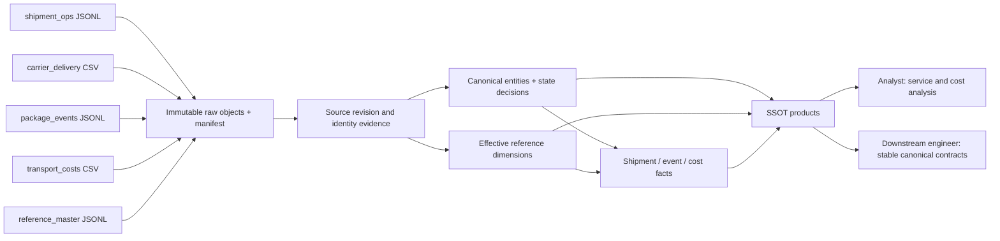

# Self-service data products

The SSOT and reference products are views in the local DuckDB profile and temporary views during Spark projection. The release publisher materializes the named products as typed tables in Redshift's `ssot` schema. These profiles share business contracts and product names; their physical SQL object types differ. A completed pipeline run replaces the public projections only after blocking quality checks pass. Failed attempts leave the previous published data available. All operational inputs are independently synthetic; no operational claims concern a real organization.

## Contract catalogue

| Product | Business description and exact grain | Owner | Freshness and quality |
|---|---|---|---|
| `ssot_shipments` | One active canonical shipment with its selected current state, observed delivery milestone, package count, readable reference values, and temporal dimension keys. | Logistics Data Platform | Updated on each accepted complete batch. `quality_status` is `PASSED` or `DEGRADED_PENDING_REFERENCE`. Withdrawn shipments remain in the fact/audit but leave this product. |
| `ssot_delivery_events` | One current revision of one namespaced source delivery observation. Multiple observers of a physical milestone remain separate observations. | Logistics Data Platform | Includes arbitrarily late event times delivered through the monotonically increasing ingestion cursor. `quality_status` discloses missing descriptive references. |
| `ssot_transportation_costs` | One current accepted source cost entry, including separately identified negative credits; corrected revisions replace the contribution with an audited change. | Logistics Data Platform | Published only after complete manifest, duplicate bridge, and amount reconciliation pass. Signed integer `amount_minor`, always EUR. Missing descriptive references are disclosed. |
| `carrier_reference` | One business-valid version of a canonical carrier. Display spelling is Type 1; operational attributes are Type 2. | Reference Steward | Dated source authority; no overlapping applicable mappings or dimension intervals. |
| `facility_reference` | One business-valid version of a facility including country, region, and operating attributes. | Reference Steward | Backdated corrections restate historical fact attribution. |
| `route_reference` | One business-valid version of a directed route and its endpoint/distance attributes. | Reference Steward | Route endpoints must agree with assigned shipment facilities. |
| `country_reference` | One business-valid version of a supported canonical country; labels are Type 1 and active/inactive lifecycle status is Type 2. | Reference Steward | Codes belong to the controlled subset; lifecycle boundaries remain effective-dated. |
| `region_reference` | One business-valid version of a canonical reporting region; labels are Type 1 and active/inactive lifecycle status is Type 2. | Reference Steward | Region lifecycle has effective history; facility-to-region membership history resides on facility versions. |
| `service_level_reference` | One business-valid service promise version. | Reference Steward | Promise/availability changes are Type 2; display spelling is Type 1. |

“Freshness” means the last successfully published input sequence, not a promise of a running hourly service. This repository does not claim an operating production SLA. The run ledger records completion/quality status; `run_id` on mart rows identifies the publishing run. A source update timestamp is not the pipeline's publication timestamp. `source_recording_delay_seconds` measures source update time minus event time; it is deliberately not labelled ingestion latency.

## Schemas and reading conventions

Use `DESCRIBE <product>` in DuckDB and `DESCRIBE TABLE <product>` in Spark to inspect runtime schemas. For deployed Redshift products, inspect `information_schema.columns` with `table_schema = 'ssot'` and the product name. [The generated catalogue](catalog.json) records the actual local DuckDB column types and nullability; it does not claim those are identical physical types in every engine. The stable business fields are:

| Product | Key and business fields | Attribution and evidence |
|---|---|---|
| Shipments | `shipment_id`, `business_key`, `order_id`, `created_at`, `promised_at`, `actual_delivery_at`, `state`, `package_count`, `shipment_count` | Canonical reference IDs; carrier/facility/route/country/region/service surrogate keys; role-playing date keys; readable names; `state_source_system`, `state_observation_id`, `state_authority`, `state_rule_id`, `raw_hash`, `run_id`, `quality_status`, `product_owner`. |
| Delivery observations | `event_canonical_id`, `source_system`, `event_id`, `revision`, `shipment_id`, optional `package_id`, `state`, `occurred_at`, `verified`, `event_count` | `source_updated_at`, `source_recording_delay_seconds`, temporal dimensional keys, `event_date_sk`, `carrier_name`, `raw_hash`, `source_run_id`, `run_id`, `quality_status`, `product_owner`. |
| Transportation costs | `cost_canonical_id`, `cost_id`, `shipment_id`, `revision`, `amount_minor`, `currency`, `cost_type`, `incurred_at` | `source_updated_at`, temporal dimensional keys, `incurred_date_sk`, carrier/route/service names, `raw_hash`, `source_run_id`, `run_id`, `quality_status`, `product_owner`. |
| Every reference product | `entity_type`, `canonical_id`, `business_key`, `canonical_value`, serialized JSON `attributes`, `surrogate_key`, `effective_from`, `effective_to`, `is_current`, `status` | `source_id`, `source_system`, `source_updated_at`, `modified_at`, `recorded_at`, `raw_hash`, `run_id`; links to immutable source evidence and publication audit provide recording history. |

`attributes` uses DuckDB's `JSON` type locally and a JSON string in Spark; the release loader maps it to Redshift `VARCHAR(65535)`. Use the engine-specific JSON functions shown below. Timestamps in SQL are UTC; ingestion requires offset-aware inputs and removes timezone ambiguity before staging. Dimension intervals are `[effective_from, effective_to)` with final sentinel `9999-12-31`. Surrogate `0` is an explicit unknown member; canonical reference IDs remain on facts so later dimension arrival can be repaired. Reference products exclude the unknown sentinel row.

For all facts, `region_sk` denotes the **origin** facility's historical region; `destination_region_sk` is a separate role. `country_sk` is the shipment's explicit country reference, while `origin_country_sk` and `destination_country_sk` derive from the corresponding facility versions. Event origin/destination attributes describe shipment context at event time, not a claimed physical scan location. When an event or cost omits its carrier reference, dimensional attribution inherits the accepted shipment carrier; the original nullable source carrier remains in the canonical observation. Contradictory/ambiguous carrier evidence must be resolved or quarantined before this fallback. The bounded executable staging contract does not project an event-location facility; original location assertions remain in source evidence.

## Lineage



A selected shipment state traces through `state_observation_id` and `state_source_system` into `shipment_state_selection`, all alternatives in `shipment_state_evidence`, then immutable source revisions/raw-object hashes. The local profile records product snapshots in `publication_history` and links execution/quality through `pipeline_runs`. The Spark profile retains accepted source evidence, resolution outputs, and immutable product releases; the Redshift publication ledger records committed release identity and sequence. Comparing retained snapshots explains restatements without claiming a dedicated arbitrary bitemporal query interface. Reference lineage uses `source_id`, `raw_hash`, and the source evidence store. Replaying immutable evidence and the same policy recreates decisions; failed attempts retain their quality results.

## Analytical examples

The first three queries use SQL supported by DuckDB, Spark SQL, and Redshift. On Redshift, qualify product names with `ssot.` or configure the session search path to `ssot`. These examples operate on named business products regardless of whether the runtime exposes a view or a materialized table.

Shipment on-time delivery by the historical contracted carrier, without mixing in estimates:

```sql
SELECT carrier_name,
       count(*) AS delivered_shipments,
       sum(CASE WHEN actual_delivery_at <= promised_at THEN 1 ELSE 0 END) AS on_time_shipments
FROM ssot_shipments
WHERE state = 'delivered' AND actual_delivery_at IS NOT NULL
  AND promised_at IS NOT NULL
GROUP BY carrier_name;
```

Cost per shipment, preserving ledger grain before joining other facts:

```sql
WITH cost_per_shipment AS (
    SELECT shipment_id, sum(amount_minor) AS transportation_cost_minor
    FROM ssot_transportation_costs GROUP BY shipment_id
)
SELECT s.business_key, s.carrier_name, c.transportation_cost_minor,
       s.package_count, s.quality_status
FROM ssot_shipments s
LEFT JOIN cost_per_shipment c USING (shipment_id);
```

Late source recording and multiple observations are observable without confusing them with shipment counts:

```sql
SELECT source_system, count(*) AS observations,
       count(DISTINCT shipment_id) AS observed_shipments,
       max(source_recording_delay_seconds) AS max_source_delay_seconds
FROM ssot_delivery_events GROUP BY source_system;
```

Inspect the generated Madrid facility's reference history using the appropriate JSON dialect. The first query is for **DuckDB**:

```sql
SELECT business_key, canonical_value, effective_from, effective_to,
       attributes ->> 'region_key' AS historical_region
FROM facility_reference
WHERE business_key = 'FAC-MAD'
ORDER BY effective_from;
```

For **Redshift**, the release stores `attributes` as a JSON string:

```sql
SELECT business_key, canonical_value, effective_from, effective_to,
       JSON_EXTRACT_PATH_TEXT(attributes, 'region_key') AS historical_region
FROM ssot.facility_reference
WHERE business_key = 'FAC-MAD'
ORDER BY effective_from;
```

In **Spark SQL**, use `get_json_object(attributes, '$.region_key')` with the unqualified temporary product view. These queries show reference versions; attributing an event or cost requires its business time to fall within the version's half-open interval.

## Quality and limitations

Blocking errors roll back publication. A `PASSED` product row means its published run passed blocking checks and the row has no pending dimension references; it does not prove facts beyond the supplied synthetic evidence. Unresolved identity is quarantined before accepted facts. Known identity with late descriptive reference data may be published with key `0`, `DEGRADED_PENDING_REFERENCE`, and a row in `pending_fact_reference`; a later effective reference triggers a deterministic restatement.

The implementation reprojects accepted evidence per publication. File/revision ingestion is incremental, but this is not a claim of fully incremental distributed mart maintenance. It is a tractable correctness baseline with separately documented measured limits. Package-level delivery is not aggregated into whole-shipment confirmation: an explicit shipment-level accepted assertion is required. Operational state candidates use the source envelope's business `effective_at`, staged as `state_occurred_at`. This preserves the difference between shipment creation, state occurrence, source update, and publication. An operational delivery confirmation therefore receives its actual occurrence timestamp, not the shipment creation timestamp.
