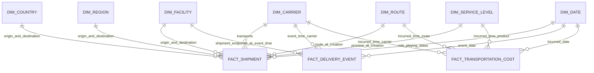

# Dimensional model

The dimensional mart supports operational performance and cost analysis with explicit business-time joins. Each fact preserves the canonical identifier plus source/run lineage so an analytical result can be traced without relying on a surrogate key as identity.

## Fact grains

| Fact | Exact grain | Measures and timestamps | Incremental identity |
|---|---|---|---|
| `fact_shipment` | One currently selected row per canonical shipment | `shipment_count = 1`, `package_count`, created/promised/selected delivery timestamps, selected state, `is_deleted`; dimensional versions resolved at shipment `created_at` | Canonical `shipment_id`; updates restate the same row with before/after audit. |
| `fact_delivery_event` | One current revision of one logical source event, namespaced by source | `event_count = 1`, normalized state, `occurred_at`, source recording delay; dimensions resolved at `occurred_at` | `(source_system, event_id)`; explicitly linked corrections revise this row and preserve prior versions in audit. Different sources' corroborating observations remain separate events. |
| `fact_transportation_cost` | One current revision of one source ledger entry allocated to one shipment | Signed `amount_minor`, `currency = EUR`, `cost_type`, `incurred_at`; dimensions resolved at `incurred_at` | `(transport_costs, cost_id)`; higher source revisions can correct metadata and amount with an explicit audit. The current revision is counted once; separate credits remain additional negative records. |

These are fact tables for **current best knowledge**, with append-only audit histories of corrections. `fact_shipment` is an accumulating snapshot: a count by shipment creation date counts shipments, not status events. Event counts must be labeled “observations” because multiple sources may report the same physical milestone. Cost totals use current accepted line revisions from complete batches. Facts do not contain a cost measure duplicated by package joins.

An explicit shipment-level event has a null package reference under the source contract. An incorrect or missing asserted package-to-shipment relationship is rejected. Package identifiers are retained as degenerate canonical keys, since a package dimension is not required for the defined analytical questions.

## Dimensions and history

| Dimension | Business key | Type 1 attributes | Type 2 attributes / version join |
|---|---|---|---|
| `dim_carrier` | `business_key`, e.g. `CAR-AP` | Display-name correction | Operating status and default service; resolve at fact business time. |
| `dim_facility` | `business_key`, e.g. `FAC-MAD` | Display-name correction | Country, region, operating status; resolve at fact business time. Origin and destination are role-playing joins. |
| `dim_route` | `business_key`, e.g. `RTE-LIS-MAD` | Display-name correction, if present | Endpoints, distance, operating status; resolve at fact business time. |
| `dim_country` | `business_key`, e.g. `ES` | Country name | Active/inactive lifecycle status retains effective history; label corrections do not create a new version. |
| `dim_region` | `business_key`, e.g. `REG-IBERIA` | Region name | Active/inactive lifecycle status retains effective history; facility membership history resides on `dim_facility`. |
| `dim_service_level` | `business_key`, e.g. `SVC-STD` | Display-name correction | Target business days and operating status. |
| `dim_date` | UTC calendar date | Calendar attributes are deterministic | No SCD; integer key `YYYYMMDD`, `0` for unknown. Separate date foreign keys support created, promised, delivered, event, and incurred dates. |

Business keys above are distinct from the stable UUID canonical IDs and version-specific `*_sk` surrogate keys.

Type 1 is used only where the project treats the old spelling/label as erroneous or analytically unimportant. It updates label fields across all versions of that entity; source observations preserve the original label. Type 2 is used when the old value explains historical performance. Each SCD2 dimension contains `*_sk BIGINT`, canonical ID, `effective_from`, `effective_to` (final sentinel `9999-12-31`), `is_current`, and `run_id`. The shared `dim_reference` stores compared tracked attributes plus source/recording timestamps. Conceptual `valid_from`/`valid_to` refer to those effective interval columns. There must be no overlapping active valid intervals for one canonical ID. The range predicate is `fact_time >= valid_from AND fact_time < valid_to`.

All facts retain route, carrier, service, and shipment identifiers appropriate to their grain. Event facts inherit the shipment's origin/destination context at event time; those role-playing facility keys do not identify an actual scan location. The bounded staging/model contract does not project a separate event-location facility. Any original event-location assertion remains source evidence rather than being inferred from the shipment destination.

## Unknown members and late dimensions

Every dimension contains exactly one unknown row with surrogate key `0`. It uses a reserved sentinel business key and must not be UUID-derived from arbitrary unresolved text. Nullable source values do not create ad hoc dimension members. A fact whose identity is valid but whose reference dimension has not arrived may load with `*_sk = 0` and an explicit `PENDING_REFERENCE` quality disposition, subject to the product's allowed threshold. The canonical foreign key and expected reference identity remain alongside it.

`pending_fact_reference` records fact type/key, missing dimension, canonical reference, required business timestamp, reason, and the current projection run. Previous pending snapshots are preserved by publication audit where configured; the table itself is current state. When a reference arrives, the loader resolves its valid-time version and updates affected facts transactionally, with old/new keys visible in successive publication snapshots. It must not choose the current version for an event that happened in the past. A newly arrived dimension with no version covering the event time leaves the fact pending.

Ambiguous identity differs from an early-arriving dimension: a fact with two plausible canonical shipment identities is quarantined, not represented as a valid unknown shipment. The unknown member is a temporary or explicitly disclosed reference condition, never a silent merge policy.

## Historical corrections

1. Accept a source correction as a higher revision of the same documented logical identity; independent financial credits use their own identities.
2. Preserve preceding source observations and retained product snapshots for audit.
3. Reconstruct valid-time intervals from accepted effective boundaries and their current corrected revisions; reject unresolved overlapping authority.
4. Re-resolve facts against those intervals. The logically affected results are the keys/measures whose source interpretation or temporal attribution changed. The implemented local and Spark profiles rebuild complete projections from accepted evidence; they do not promise to issue updates only for affected rows or partitions.
5. Reconcile counts, state, money, and referential/temporal integrity before publishing the new snapshot, retaining prior evidence and release history.

A backdated facility-region change alters the facility surrogate chosen for facts in the changed interval and their role-playing region keys. A bounded backfill chooses ingestion sequences to replay; it does not change the full-projection reconstruction strategy. Surrogate keys remain deterministic, and a same-content rerun creates no new accepted versions or committed release.

## Withdrawals, retention, and joins

Shipment tombstones set `is_deleted = true`; the source delete operation remains in evidence, and the SSOT shipment product excludes withdrawn rows. No separate withdrawal-reason column is asserted by this bounded schema. Recognized cost corrections use a higher revision or a separately identified signed credit. An explicit cost tombstone withdraws its current fact contribution while retaining all earlier evidence and snapshots; a missing partial feed cannot perform that withdrawal. Dimension deactivation closes or versions lifecycle status without erasing historical foreign keys.

Redshift constraints document intended primary and foreign keys but are not relied upon as enforcement. SQL quality gates enforce uniqueness, valid intervals, no orphans except approved key `0`, event chronology, and signed amount reconciliation. Distribution/sort decisions and materialized-view performance claims require actual warehouse EXPLAIN and run artifacts. The delivered Redshift benchmark harness has not been executed against a live warehouse; [recorded local measurements](benchmarks.md) are a separate evidence profile.

Country and region display labels are Type 1, but lifecycle status changes retain an effective boundary. A deletion must produce an INACTIVE interval even when the display name and other attributes are unchanged; it must not disappear during change-island compression.
