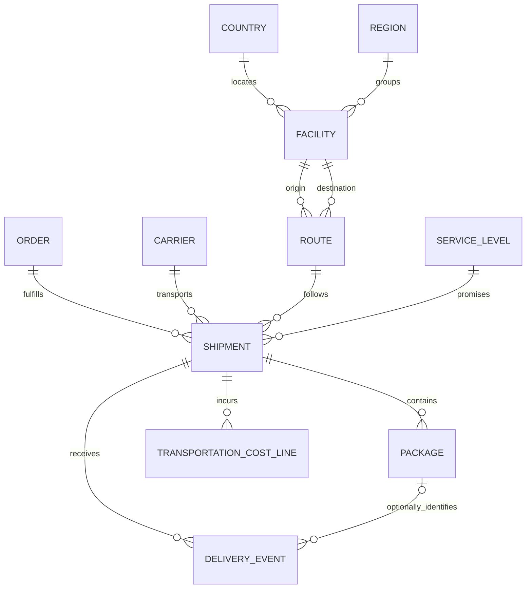

# Domain model

This repository models a fictional European logistics organization. Every operational record, carrier, facility, route, identifier, incident, and workload is generated independently for this project. Aster Parcel, Meridian Freight, and Vale Courier are fictional carrier names. Public country codes are reference values, not claims of operational presence.

## Business boundaries

The platform publishes an explainable view of shipment execution and transportation charges. It integrates five synthetic source systems: `shipment_ops`, `carrier_delivery`, `package_events`, `transport_costs`, and `reference_master`. No source is authoritative for every attribute. Raw observations remain immutable; selected values carry a reason and traceable source evidence.

An **Order** is a customer fulfillment request. An **Order** may produce multiple **Shipments**, but a shipment belongs to exactly one order. A **Shipment** is a transport commitment between an origin and destination facility, performed by one carrier under one service level over one route. A **Package** is one physical handling unit within a shipment. A package identifier cannot be reassigned to a different shipment without an explicit audited correction.

A **Carrier** is the contracted transport organization. A **Facility** is an operational location; its label, region assignment, and operating state can change. A **Route** is a directed, named connection between two facilities. Reversing the endpoints creates a different business route. A **Country** is a supported ISO alpha-2 country code. A **Region** is an independently designed reporting grouping, not an implied legal or carrier territory. A **ServiceLevel** specifies the product promise, such as a target number of working days; promise changes have valid-time history.

A **DeliveryEvent** is an observation about a package or shipment at an event time. A **TransportationCostLine** is a signed charge or credit assigned to one shipment. These are first-class transactional relationships even though they are not master entities.

## Semantic contracts

| Topic | Contract |
|---|---|
| Time | Persist UTC timestamps with timezone. Retain raw timestamp text and declared offset. Reject local timestamps lacking an offset or an explicitly configured source timezone. Event time, source modification time, ingestion time, and warehouse recording time are distinct. |
| Money | Signed integer EUR cents; no binary floating point. Non-EUR values are quarantined until an explicit currency policy exists. Credits are negative lines. The same ledger entry revision is never added twice. Posted amount corrections use an audited higher revision; additional credits have separate identifiers. |
| Identity | Source IDs are scoped to their source and entity type. Global business keys exist only where the generated source contract explicitly supplies them. A label, geographic proximity, or similar spelling is not identity evidence. |
| History | SCD Type 2 uses `[valid_from, valid_to)` business validity. `recorded_at` and a run ledger preserve when a version was known. Historical correction does not destroy the previous assertion. |
| Deletion | A source tombstone withdraws that source assertion. It never physically removes raw data, costs, events, or lineage. A business cancellation is a state, not a delete. |
| Completeness | A complete source batch includes an expected file inventory, expected records, and, for cost feeds, an expected signed amount. A syntactically valid partial batch is incomplete. |
| Uncertainty | Missing identity, conflicting curated mappings, and contradictory strong identifiers are explicit unresolved outcomes; downstream publication cannot silently guess. |
| Ownership | `Logistics Data Platform` owns integration and product contracts; `Reference Steward` owns curated identity and reference assertions. These are fictional project roles, not named real people. |

## State and event interpretation

Supported shipment states are `created`, `collected`, `in_transit`, `out_for_delivery`, `delivered`, `delivery_failed`, `returned`, and `cancelled`. The source contract declares how source status codes normalize to these values. A transport can proceed directly from an earlier state to a later state when intermediate observations are missing; absence of an observation is not proof that a step did not occur. `delivery_failed` can return to an active state; explicit `delivered → returned` observations are permitted. Terminal reversals require an explicitly identified correction and preserved evidence.

Events are ordered by event time, deterministic source precedence, source modification time, and a stable event identifier. Arrival order is never the event chronology. Precedence selects the assertion allowed to represent a business attribute; it does not erase contrary observations. A package-delivered observation alone cannot prove the whole shipment delivered when expected packages remain open. Late observations may change historical event sequences and require a state recomputation for the affected shipment.

## Boundaries of authority

`reference_master` establishes curated carrier, facility, route, country, region, and service-level mappings. `shipment_ops` establishes global shipment/order/package relationships. Delivery confirmation requires the evidence defined by source precedence. `transport_costs` owns cost line amount/revision, subject to batch reconciliation. None of these rules authorizes a join between different entities merely because they share text.

The canonical layer stores stable identity and selected, auditable business assertions. The SSOT products expose current and historical contractually defined business views. Dimensional marts provide time-aware analytical joins. These layers share keys and definitions; each serves a different read pattern.
